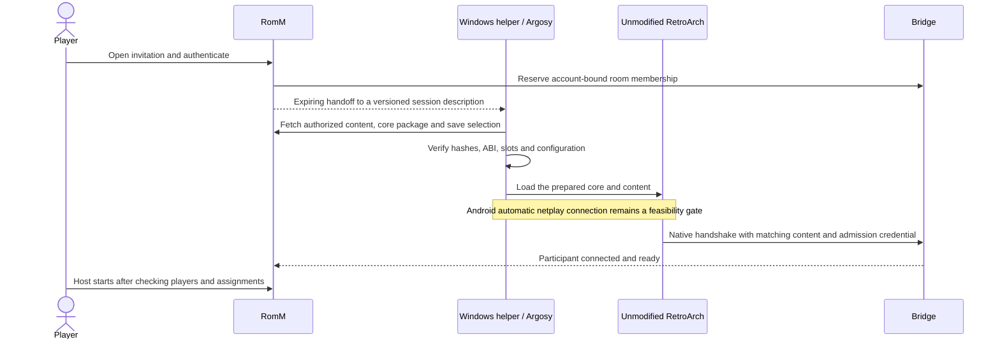

> Historical implementation notes. Installation instructions and compatibility claims below are superseded by the current guides one directory above.

# RomM rollback rooms

The v2 player offers multiplayer rooms for SameBoy (GB/GBC), mGBA Splitscreen (GBA), and Snes9x (SNES) when the independent RetroArch netplay bridge is configured. Every participant runs the game locally; the bridge carries inputs and synchronization messages. Supported games' in-game **Netplay** buttons open this room flow when the bridge is enabled. Without it, existing multiplayer entries remain available.

The current implementation includes Windows session preparation and account-bound native admission. It is deployed to the local LAN test server at `https://192.168.3.112:8443` on the `custom/netplay-retroarch-bridge` fork branch. Android implementation remains deferred. The [implementation status and scope](#planned-native-session-preparation) below distinguish new verification from earlier results.

| System | Qualified core version                     | Room content and save behavior                                                                                                                              |
| ------ | ------------------------------------------ | ----------------------------------------------------------------------------------------------------------------------------------------------------------- |
| GB/GBC | SameBoy `1.0.4c87d256-rollback2`           | Two ordered GB/GBC cartridges, including different games; each web participant owns their battery data.                                                     |
| GBA    | mGBA Splitscreen `0.1.0-f1d5975-rollback2` | Two to four ordered cartridges, including different GBA games; each participant owns their assigned save. The new Windows runtime check covers two players. |
| SNES   | Snes9x `1.632d4cce69`                      | One cartridge and two joypads; the host supplies the shared initial save. Both participants can save the shared progress to their own account.              |

SNES rooms currently accept standard, non-interleaved **NTSC LoROM/HiROM** cartridges up to 4 MiB with an unambiguous valid header. Raw `.sfc`/`.smc` and ZIP archives containing one cartridge are supported, including 512-byte copier headers. PAL, extended/interleaved images, and ambiguous or invalid headers are rejected before starting a room. The qualified frontend clock is NTSC; PAL timing must be implemented and verified before enabling it.

Open the room from the v2 game page, create it, and share its **room invitation** and optional **room password** separately. A blank creation password means no room password is required. Web invitations still require access to that game through a RomM account. Everyone enters with no player number selected. Guests may change only their own number; the host can assign anyone's number. Each participant chooses **Web browser** or **Windows RetroArch** and selects **Join game**. A player number alone never starts the web core, including after reconnecting. Once all slots have joined and have unique numbers, the host selects **Start game**. EmulatorJS controls stay hidden throughout the waiting room and cartridge preparation. Web gameplay stays in the same page. **Netplay** opens the room panel inside EmulatorJS, with player assignments and live ping beside each participant. **Return to game** or Escape closes the panel without disconnecting or restarting the game. Controller input is neutral while the panel is open. The game toolbar appears during play and stays hidden in the room panel; volume, shared pause and save synchronization use that toolbar. Windows RetroArch users keep the browser room open to see members and ping while playing in the native client.

Each GB/GBC or GBA participant brings the cartridge and save selected on their game page before opening **Relay server**. The room has no additional cartridge picker. Its participant list shows each cartridge name beside the player's client and ping. The host can **Remove** another participant; their connection and launch credential are revoked, and their account cannot rejoin that room. Other participants stay connected. Any compatible cartridge may enter the room. A different cartridge waits for the next game, without changing the running game or forcing the participant out after a waiting timeout. Once everyone has a number, the host can select **Prepare new game** to return everyone to the same room. Participants select their client and **Join game** again, then the host selects **Start game** to apply the new cartridge set. No cartridge picker appears during gameplay.

After selecting **Web browser** and **Join game**, a compatible web participant joining a running game loads a current snapshot and the following inputs, then catches up without resetting the running game. This uses the existing cartridge set and console assignment; it does not inject a new starting save into the running game. A running browser supplies a confirmed snapshot, or an existing RetroArch peer supplies its current state. Input replay is bounded to 600 frames per player and snapshot requests time out after ten seconds. Expired history returns an error only to the joining player.

Web and RetroArch hosts publish their current frame to playing web guests. A guest that falls behind catches up by at most one extra muted frame per tick. Rejoin and host changes discard the old clock reference. Selecting **Windows RetroArch** and **Join game** also resumes automatically when a compatible slot and live source are available. Active clients briefly synchronize from the current full state; the host does not select Restart. Paused games wait for resume. Recovery after all replicas have closed is not guaranteed.

Restart preparation keeps the other participants' existing web game view visible, with pause and save controls disabled until synchronization completes. An already open Netplay panel remains open. Save synchronization errors appear as notifications with details in Netplay, without opening the panel over gameplay. Reconnecting the same Windows account, cartridge and core preserves the save's conflict baseline and confirmed progress ordering; outside edits still cause a conflict.

**Save and return to room** closes only the web game, uploads its save and releases its core. It is available from the game toolbar and the Netplay panel. The participant stays in the room with the same player number and can choose a client and select **Join game** again. Closing RetroArch, cancelling its preparation, or letting preparation expire also returns to the same open browser room. No web game starts automatically. A launcher closed before it connects remains in preparation until cancelled or expired.

**Leave room**, leaving the room page and closing its tab disconnect that account. This also revokes a pending Windows handoff or disconnects that account's active RetroArch client. Other accounts remain connected. The room closes when its last participant leaves.

Current link cores keep the virtual console and cable attached when input becomes inactive. Per-participant cable removal on full room departure is designed in the standalone project's `docs/room-lifecycle.md`: all replicas apply an authoritative cable change at the same emulated frame, with topology included in rollback snapshots. This needs matched new web/native cores and is not enabled in the current builds. Closing only a game while staying in the room is intended to keep its cable attached.

The host's first **Start game** fixes cartridge order from the chosen player numbers. Browsers and the Windows helper automatically fetch the same complete set before synchronized play starts. Every participant must have RomM permission to access every cartridge in that set. Different games still require a compatible link protocol; loading them together does not by itself establish game-specific trade support.

The embedded room UI is checked with a simulated core in both themes, keyboard, mouse and touch. Checks cover in-game Netplay, live ping, return without disconnect, neutral input during room interaction, explicit exit, page closure, and Windows handoff with the room still visible. Both cross-origin-isolated documents and ordinary SPA entries are covered. Earlier session changes passed 63 serial broker/client tests and three focused membership API tests. A mock core verifies byte-identical rejoin state while the other participant continues without a restart. A bounded Windows runner also verified native/native rejoin, web-to-Windows handoff, and a native host rejoining from a surviving web source with mGBA diagnostic cartridges. All three preserved current progress and saves, accepted later input, and passed subsequent state checks without an extra host Start command. These are short two-player tests; Android, long sessions and other game/core combinations remain unqualified.

Earlier launcher work passed 94 focused API tests and Windows PowerShell checks for reusable per-user registration and launch-link validation. A deployed HTTP/WebSocket probe verified pending Windows manifests, ordered cartridge downloads and credential revocation. The revised room UI and rejoin checks use simulated cores; gameplay qualification remains for user testing. No WSL native emulator or image build was run.

The launcher seeds all ordered cartridge saves before the native host supplies the synchronized initial state. With the broker's durable save queue enabled, both web and Windows progress is stored by the server, including native-only rooms. The broker extracts cartridge SRAM from periodic snapshots, and RomM's scheduled task consumes pending saves once per minute. Web Sync and Save and return to room also request an immediate sync. Each original participant receives a separate room save under their own account and selected ROM; the initially selected save is preserved. Generation/frame ordering and outside-edit checks prevent stale or conflicting writes. Pending saves survive room deletion and bridge restart when its volume is retained. If every client closes abruptly, progress after the latest received snapshot can be lost. See [server save operation](NETPLAY_BRIDGE.md#server-save-synchronization). Web rooms honor the player's explicit save selection or fresh start. Direct invitations use the most recently updated compatible save. Web GBA rooms accept compatible raw saves from both `mgba` and `mgba_splitscreen` and write progress to the room's own core/slot. Other cross-core battery imports are not qualified. Switching from a running single-player session copies its current battery data after uploading it; an unsuccessful upload prevents the handoff. Direct save-state selection is rejected with instructions to load it in single-player first.

For Windows, download **Windows launcher (first setup)** once from **Play in RetroArch**, extract it and open **Register Launcher.cmd**. This copies the helper to `%LOCALAPPDATA%\RomMNetplay\Launcher` and registers `romm-netplay` links for the current Windows user, without administrator access. For each game, select your cartridge and starting save in RomM, enter the room, choose a player number, select **Windows RetroArch** and its architecture, then click **Join game**. Allow the browser to open the launcher. No per-room ZIP download is needed. **Unregister Launcher.cmd** removes the link registration while preserving RetroArch and cached game files.

Downloading or registering the launcher leaves room membership unchanged. Opening it creates a single-use, three-minute request tied to the current account and room. Only the launcher's authenticated claim switches that same web participant into native preparation; the participant ID and player number stay the same. Permissions and current membership are checked again when the request is claimed. The badge changes to **Windows · RetroArch** only when RetroArch connects successfully. If browser launch is cancelled, the web participant remains connected; **Open launcher again** reuses the pending request until it is claimed or expires.

For a new GB/GBC or GBA room, the helper waits until the host selects **Start game**, then obtains the final cartridge order automatically. It first checks the remembered executable, PATH, registered installations and common folders for a matching RetroArch. If none exists, it downloads the pinned official portable RetroArch **1.22.2** for Windows x64/x86 and caches it under `%LOCALAPPDATA%\RomMNetplay\runtimes`. ARM64 requires an existing matching RetroArch, or select Windows x64 to use the portable runtime through Windows emulation.

The helper verifies and caches the core and ordered ROMs, prepares an isolated configuration, authenticates through a temporary loopback TCP relay and starts the unmodified RetroArch. RetroArch 1.22.2 only prompts interactively for a client password; `netplay_password` is a server setting, so the helper completes that exchange on its behalf. RomM credentials are never sent to the public RetroArch download server.

New account-bound rollback rooms prefer RetroArch as the host, then a web player. Both players may switch to Windows; no web emulator is required. Each browser remains a room-control view and does not occupy an additional slot. The native host selects **Start game** from that page. The relay obtains the host's serialized state, distributes it and uses its frame progress as the timing reference. If the host leaves, another playing RetroArch takes over, then a playing web participant. Waiting native rejoins still require a host-controlled restart. Closing a room page disconnects its Windows client.

For this update, download the launcher again and run **Register Launcher.cmd** on each Windows PC, refresh the room page and create a new room. Manifest version 3 requires a helper that stages the selected save for every cartridge in RetroArch's `saves/.netplay` directory (`.sav`/`.sav2`/`.sav3`/`.sav4` for mGBA; `.srm` for SameBoy and Snes9x). Fresh starts use new session save directories. The launcher downloads the matching updated mGBA core automatically: it must expose save memory before the first frame so RetroArch can restore the selected saves. No new RetroArch executable is required. Wire/client fixtures cover native-only start and native-to-native-to-web host transfer; actual Windows gameplay and native rejoin remain for user verification.

The launcher does not need administrator rights. With a publicly trusted HTTPS certificate, no certificate installation is needed. For a private CA, the administrator can set `NETPLAY_BRIDGE_CA_CERT_PATH` to a read-only PEM/DER root CA file. Windows ZIPs then include `RomM-CA.cer` and **Install Certificate.cmd**: extract the ZIP, run the installer once on each Windows computer, then register the launcher and open it from the room. The installer verifies the bundled certificate hash and installs only into **Current User > Trusted Root Certification Authorities**, skipping an already trusted certificate. It works offline before the first HTTPS request; ordinary playback does not modify trust stores. Only the public CA certificate is included, never its private key. Leave this setting empty when using a public CA such as Caddy's Let's Encrypt certificates. The LAN test server has this option enabled. Browser certificate exceptions do not apply to PowerShell, and TLS validation remains enabled.

Windows mGBA sessions show and play audio from only the assigned player's console. The helper reads RetroArch's own-player device assignment from the existing netplay MODE message and selects the core's focus view. Until the host starts and confirms the assignment, the native screen and audio are blank. All linked cartridges continue running, and display selection stays outside synchronized state. Core downloads follow the room manifest; when the helper itself changes, download the launcher again and rerun **Register Launcher.cmd**. Manual launches can select **Quick Menu → Core Options → View layout → Focus (single screen)** and their **Focused player**.

Manual clients in new prepared rooms must use their generated personal password, not the optional invitation password. Native gameplay still needs the complete ordered cartridge set. SameBoy uses 48000 Hz audio. The new mGBA profile distributes web, Linux and Windows builds; older Android rollback1 cores cannot join rollback2 rooms.

Dedicated assets live below `custom-emulatorjs/data/cores/compat/rollback/`. Each package includes the matched WASM bundle, native cores, upstream license, source revision, patches where needed, `BUILD.txt`, and SHA-256 manifests. Existing single-player and standalone handheld link assets remain available through their previous paths.

## Audio and rollback

The core suppresses audio and video for replayed frames. Rollback therefore does not play each replayed sound again, but replay work and input stalls can delay the next output buffer. Room audio uses 60 ms of scheduling headroom, a 2 ms transition at discontinuities, and an 8 ms gain ramp for volume/focus changes. Pause clears pending audio. Queue growth is capped at 250 ms and frame catch-up is limited to three frames and an 8 ms budget per timer callback.

A two-browser mGBA diagnostic at 800 × 600 with 60 ms FIFO input delay recorded 65 scheduled output gaps without buffering and 19 with buffering over about 600 frames per peer. Both runs emitted zero audio buffers during replay. This is one scheduling measurement with diagnostic cartridges, not a listening test or a general performance guarantee. The buffered run sustained about 55 FPS, below the target rate, and still had gaps up to 125 ms. Recovery can produce a longer pause while refilling; buffering cannot fix sustained CPU shortages or long network stalls.

## Game ownership policy

Each prepared game fixes the account, console number and cartridge for every player. The same account can resume its original console. Another account may wait in the room but cannot inherit its previous occupant's snapshot or save by selecting that number, even after all clients have closed. The room explains this waiting state and the host can select **Prepare new game**. Everyone then joins again and starts from their own save; SNES continues to use the host's shared save.

The broker enforces this at web snapshot transfer, native admission and launcher save delivery. RomM native uploads also require the original account/cartridge/player binding and current generation. Deploy the broker and adapter together; uploads fail closed when ownership metadata is absent. Full-state rollback still shares state among authorized co-players. Server-owned save synchronization preserves this ownership policy and introduces no new core protocol.

## Reproducible integration verification

Run `node scripts/verify-rollback-rooms.mjs` from the RomM repository with the prepared diagnostic cartridges and cached headless browser. The script imports the real independent broker from the sibling `retroarch-netplay-bridge` directory; `NETPLAY_BRIDGE_SOURCE` overrides that location. `NETPLAY_UI_SYSTEMS=gb,gba,snes` selects systems, and `NETPLAY_UI_OUTPUT` changes the evidence directory. RomM's authenticated HTTP API is mocked per account; the broker, WebSocket transport, installed core packages, cartridge extraction, core state, rendering, audio, and save bytes are real.

The latest run in `result/netplay-interop/romm-rollback-rooms/result.json` passed mGBA and SNES at **at least 600 common confirmed frames**, with byte-identical states and 10 CRC checks per peer. SameBoy gameplay was not rerun. Forty-millisecond remote-input delivery delays produced six host and two guest rollbacks per system. Both keyboard seats, gamepad input, real touch events on the virtual A button, touch pause, local audio, and per-account SRAM uploads passed. The SNES fixture was loaded through a real ZIP extraction worker, and both accounts preserved the host's shared SRAM seed. Dark and light layouts fit widths from 320 to 3840 pixels.

After building the production frontend, run `node scripts/verify-bridge-launcher.mjs` to check the actual v2 launcher. Its recorded **12 scenarios passed**: configured and unavailable room buttons, both themes, mouse, Tab/Enter, trusted touch, standard Gamepad API activation, and layouts at 320, 768, 1280, and 1920 pixels. The ordinary SNES player boots the real qualified Snes9x WASM package; its Netplay toolbar pauses the core and completes the SRAM upload before the room handshake. This also passed when the broker configuration response was delayed by three seconds and Play was pressed before it arrived. The script uses isolated HTTP API fixtures and an inline player handshake recorder; room networking is covered by the separate test above. It disables the optional screen Wake Lock API in headless Chrome, makes no deployment requests, and closes the browser on completion. Evidence and screenshots are in `result/netplay-interop/romm-bridge-launcher/`; `NETPLAY_LAUNCHER_OUTPUT` overrides this directory.

These results cover original diagnostic cartridges and a two-browser room. Longer native RetroArch qualification and standalone broker CI are documented in the independent project's qualification report. They do not establish compatibility for every commercial game or additional GBA player counts. The browser is always closed in `withHeadlessBrowser`'s cleanup, and the three systems run sequentially to limit memory use.

## Planned native session preparation

Scope review and local implementation: **2026-11-02**. Windows/shared contract/mGBA work below is implemented locally; Android remains a proposal. The review used RomM integration revision `6feb5e3184cf892b5924d23898bd919284cb0e3b`, bridge revision `0f22e1e94416141b95477baa380b88957b3ae111`, local Argosy revision `1d58f897126c4b7f9d962b90f2ce946d78b94a75` (2.19.3), and RetroArch 1.22.2 source. The worktrees contain earlier local changes; source inspection does not qualify those changes or current upstream Argosy releases.

### Current implementation and verification

- Broker transport/session tests: **59 passed**, including one account/one member during handoff, host transfer with separate native wire numbering, seat preservation, expiry and fresh-save replacement.
- Affected backend tests: **68 passed**, covering account/ROM access, scoped downloads, ZIP packaging, seat ownership and confirmed-save destinations/conflicts. Generated API types and their strict targeted type check passed. Full `vue-tsc --build` exceeded the 2 GiB Node heap cap and remains unverified; WSL limits were not raised. Trunk Python checks passed. Trunk could not discover an ESLint configuration for `custom-emulatorjs`; a separate targeted ESLint recommended-rules check passed for the changed adapter scripts.
- Windows x64 mGBA diagnostic: distinct cartridge IDs 1/2 and 113 link receipts each; exact restoration/replay after 120 frames.
- Stock Windows RetroArch **1.22.2** with the real helper and WASM host: **300 confirmed frames**, **five state checks**, **294 link receipts**, selected native SRAM preserved, no resynchronizations and exactly two members after browser handoff. Lobby wait exceeded ten seconds. This short diagnostic does not qualify commercial Pokemon trading, native rejoin, every game or audio quality.
- Web UI fixture: both themes, keyboard/touch activation, own-seat permissions, Windows badges, two-member count and a 390-pixel touch viewport. Runtime Android and Windows ARM64 tests were not performed. Windows x86/ARM64 DLLs passed artifact/ABI inspection only in this revision.
- Windows emulator checks run outside WSL under a 1.5 GiB job memory limit, two CPUs and a 60-second deadline. No native emulator/rejoin workload was run in WSL. Evidence is under `result/netplay-interop/mgba-multi-rom/` in the workspace.
- Portable preparation checks passed on Windows: existing executable first, explicit override, ABI filtering, official archive extraction and cache reuse. LAN checks passed for login, scoped package/content downloads and artifact hashes.
- Windows x64 display checks compared the P1/P2 focus output pixel-for-pixel with their original composite regions, verified a blank unassigned view, and compared identical serialized states after 120 frames in every view. The helper recognized P1-P4 assignments and forwarded a 1 MiB state packet without changing bytes. No native rejoin qualification was repeated.

The new API is `POST /api/netplay/bridge/rooms/{id}/native`, followed by scoped package/content downloads using `X-Netplay-Launch`. The preparation expires after 15 minutes; successful native authentication consumes its admission password. The helper source is `client/windows-session.ps1` in the independent bridge and is synchronized into the adapter. No OIDC provider, new repository or modified RetroArch executable is required. HTTPS downloads retain certificate validation; a private CA must be trusted by Windows.

### Direction and boundaries

- **Windows:** use a small session helper in the existing independent bridge project. It finds an existing RetroArch before downloading a portable fallback, prepares the matched core, core info, ROMs and session configuration, then starts the unmodified RetroArch. A new repository is unnecessary.
- **Android:** extend the existing Argosy fork with a bridge-room adapter and launch external RetroArch. Reuse Argosy's RomM account, download and external-launch infrastructure. Retain RetroArch as the emulator application.
- **RomM:** continue owning account authentication, library permissions and save ownership. A separate identity service or new OIDC provider is unnecessary for this scope. Windows can redeem a short-lived handoff issued after browser login; Argosy can use its configured RomM account.
- **Bridge:** prefer native state and timing authority, with web fallback, while retaining the broker input/state transport. Native-only rooms require no browser emulator or video streaming. Core priority remains SameBoy, then mGBA, then Snes9x.

Argosy's built-in netplay uses its own rollback path. Its published support list excludes GB/GBC/GBA link play; adding our bridge to that engine would require a separate protocol and native integration effort. The external RetroArch adapter is the smaller first scope. This is an architectural recommendation based on the inspected paths, not a demonstrated Android launch result. [Argosy netplay documentation](https://github.com/rommapp/argosy-launcher/wiki/Netplay)

### What the current source establishes

| Finding                                                                                                                     | Consequence for the plan                                                                                                                                              |
| --------------------------------------------------------------------------------------------------------------------------- | --------------------------------------------------------------------------------------------------------------------------------------------------------------------- |
| RomM bridge rooms identify one `romId`; `input-netplay/bridge.js` repeats one cartridge for every handheld slot.            | The active bridge flow needs an ordered content list before it can offer different cartridges per player. The older web link flow's ROM picker alone is insufficient. |
| The original rollback1 mGBA loader read only `info[0]`; rollback2 now owns and loads every slot.                            | The new patch and matching native/WASM packages implement ordered multi-ROM loading; older packages remain incompatible.                                              |
| Native guests receive the host's initial synchronized state.                                                                | Copying a personal `.srm` beside the guest ROM does not implement personal-save import; the host state can replace it.                                                |
| Web reservations carry an owner and one-use token; native admission checks the room password and accepts a client nickname. | An account-bound launcher reservation needs a corresponding native admission mechanism. A nickname is not proof of the RomM account.                                  |
| Argosy `GameLauncher.commandForRetroArch` already builds `ROM`, full-path `LIBRETRO` and `CONFIGFILE` extras.               | External launching can be extended; a replacement emulator frontend is not the starting requirement.                                                                  |
| Argosy `NetplayPreflightChecker` resolves built-in cores through `LibretroCoreManager` and `LibretroCoreRegistry`.          | Its preparation flow is a useful pattern, but its downloaded cores and transport cannot be treated as external RetroArch support.                                     |

Core observations refer to `result/netplay-interop/mgba-rollback/v4/native-source/src/platform/libretro-splitscreen/{libretro.c,instances.c}` and its WASM source counterpart in the development workspace. Implementation must update the maintained core patches/build inputs in the independent project, not only those generated working copies.

### Proposed user flow

Room membership can exist before RetroArch loads content. That is an authenticated lobby presence in the helper, not an early RetroArch gameplay connection: native synchronization still needs a loaded core and content. Show separate preparing, connected and ready states. Everyone initially has no player number; guests may select only their own number and the host may assign any participant. Reservation expiry must allow downloads and must not consume the existing short-lived WebSocket credential prematurely.

Keep the existing departure/rejoin intent: one departing player does not end everyone else's game, and the host can admit a replacement and restart from a defined synchronization point. Reservations must release cleanly on cancellation or expiry. Do not count the helper connection and its RetroArch connection as two players. This extension does not establish the still-incomplete native restart qualification.

### Shared contract and server changes

The following describe the contract requirements; exact implemented field names are defined by `BridgeNativeRequest`, `BridgeNativeResponse` and the schemaVersion 1 session package:

| Contract part | Required information and behavior                                                                                                                                                                             |
| ------------- | ------------------------------------------------------------------------------------------------------------------------------------------------------------------------------------------------------------- |
| Session       | Schema version, room ID, manifest revision, participant ID, assigned seat and supported launch capabilities.                                                                                                  |
| Core profile  | Core ID and exact build revision, state format, deterministic options, player count, subsystem identifier where applicable, and required timing/audio settings.                                               |
| Artifacts     | Platform and RetroArch process ABI, core and `.info` artifacts, checksums and authenticated download references. Browser OS detection remains a suggestion; the installed application's ABI is authoritative. |
| Content       | An ordered list of slots with RomM ROM IDs, archive member selection where needed, hashes of the actual loaded ROM bytes, and deterministic local names. SNES remains one ROM with multiple joypads.          |
| Saves         | Per-slot owner, exact selected save ID/revision or explicit fresh start, conversion/profile requirements and permitted upload destination.                                                                    |
| Connection    | Public host, native port, expiry and an account-bound admission handoff. Never expose the bridge admin credential.                                                                                            |

Extend `backend/endpoints/netplay.py`, `backend/endpoints/responses/netplay_bridge.py` and `backend/handler/netplay_bridge_handler.py` to authorize every cartridge in the session and issue/redeem preparation handoffs. Reuse the existing file and save services. Version the contract before changing generated frontend types. Extend `frontend/src/v2/components/Player/BridgeStage.vue`, `custom-emulatorjs/input-netplay/bridge.js` and `native-downloads.js` for native preparation, readiness and per-slot choices, while keeping the established EmulatorJS room panel.

In the independent project, `server.mjs`, `native.mjs` and `PROTOCOL.md` need reservation-to-native binding, manifest validation and preparation lifecycle changes. Prefer a per-participant credential using RetroArch's existing password exchange, subject to checking the exact client's credential handling. Keep the visible optional room password separate from this generated credential. If manual clients remain supported under strict account-only admission, their account page must also issue that credential; the current shared room password alone does not enforce the policy.

Freeze the manifest revision used by all ready clients. Changing cartridge order, player count or deterministic settings invalidates readiness and requires re-preparation. Preserve strict native content checks: define and verify how the ordered ROM identity maps to RetroArch's actual content CRC for each launch mode. Disabling CRC checks would hide incompatible sessions.

### Windows helper scope

This is a new client component in the existing bridge repository, with moderate scope before multi-cartridge and personal-save support:

1. Accept a RomM-issued launch handoff and look for an existing `retroarch.exe` with the matching architecture. Support an explicit executable path; otherwise download the pinned portable Windows x64/x86 runtime when discovery fails. An expired handoff requires preparing the room again.
2. Download/cache matching native core and `.info` packages and authorized ROM bytes, verify them, and prepare an isolated session directory. Deduplicate identical cartridge downloads while retaining separate save slots.
3. Generate a session configuration from the user's settings plus the locked room requirements. Preserve controller preferences, use session save paths, and prevent auto-resume states from overriding the selected initial save.
4. Start RetroArch with an argument array using its core/content, config, subsystem and netplay CLI capabilities. Read subsystem identifiers from the matched profile. Do not interpret a server-supplied shell command. [RetroArch CLI documentation](https://docs.libretro.com/guides/cli-intro/)
5. Track launch failure, native readiness and process exit; return useful connection diagnostics to the room. Add save upload only after the per-slot ownership and confirmed-state rules below are implemented.

The helper handles installation and launch preparation. It does not fix state incompatibility, rollback timing or the native disconnect issue by itself. Existing local fixes still require their own Windows gameplay confirmation before publication.

### Android and Argosy scope

RetroArch's Android launch interface accepts a content path, core path and configuration path through Intent extras. The inspected 1.22.2 Android argument reader (`frontend/drivers/platform_unix.c`) and exported command table (`command.h`) do not expose an equivalent of the desktop subsystem-plus-connect CLI through those extras. Writing host/port settings alone has not been shown to initiate a client connection. Do not invent `SUBSYSTEM`, `NETPLAY` or arbitrary command-line extras. [Android launch documentation](https://docs.libretro.com/guides/cli-intro/#on-android)

There is a promising core-install route: 1.22.2 exports `CoreSideloadActivity`. It copies a core from a readable file into RetroArch's own core directory and starts RetroArch, using its default configuration. It does not install `.info` metadata or forward an arbitrary session configuration. This needs a staged install/launch flow and verification against the installed APK; it is not evidence that every Android distribution supports unattended installation. [Sideload implementation](https://github.com/libretro/RetroArch/blob/v1.22.2/pkg/android/phoenix/src/com/retroarch/browser/debug/CoreSideloadActivity.java), [exported activity](https://github.com/libretro/RetroArch/blob/v1.22.2/pkg/android/phoenix/AndroidManifest.xml)

Argosy cannot write directly into RetroArch's private `/data/data/.../cores` directory. Its own core download directory is not a RetroArch installation directory. Use a supported RetroArch import path and files readable by the receiving app; retain a guided manual import fallback. A FileProvider URI grant must not be assumed to make a raw filesystem path readable. [Android app-specific storage](https://developer.android.com/training/data-storage/app-specific)

Paths in the following table are relative to `app/src/main/kotlin/com/nendo/argosy/` unless stated otherwise:

| Area                    | Existing entry points                                                                                                     | Proposed modification                                                                                                                                                                                                                                           |
| ----------------------- | ------------------------------------------------------------------------------------------------------------------------- | --------------------------------------------------------------------------------------------------------------------------------------------------------------------------------------------------------------------------------------------------------------- |
| RomM room API           | `data/remote/romm/RomMApi.kt`, `RomMApiClient.kt`, `data/repository/RomMAccountRepository.kt`                             | Add a separate bridge-room repository using the selected account, capability checks, reservation and preparation requests.                                                                                                                                      |
| Invitation and lobby UI | `MainActivity.handleDeepLink`, `ui/navigation/NavGraph.kt`, `ui/components/NetplayJoinModal.kt`                           | Add a distinct bridge invitation route and preparation UI. Reuse UI patterns without routing into Argosy's existing friend/netplay transport. Redact handoff tokens from the existing deep-link logging. Support touch and gamepad navigation.                  |
| ROM/core preparation    | `data/download/DownloadManager.kt`, `data/emulator/EmulatorRegistry.kt`                                                   | Reuse ROM downloads; add an external core package/import adapter with exact build and APK ABI selection. Do not register these as built-in `LibretroCoreRegistry` downloads.                                                                                    |
| Launch resolution       | `data/emulator/GameLauncher.kt`, `EmulatorResolver.kt`, `domain/usecase/game/LaunchGameUseCase.kt`                        | Carry a session launch specification with core, content and config paths. Both emulator resolvers must select the same external package so save restoration follows the launched emulator.                                                                      |
| Storage and save paths  | `data/storage/FileAccessLayer.kt`, `data/emulator/RetroArchPathResolver.kt`, `data/sync/platform/RetroArchSaveHandler.kt` | Stage session files through the existing storage abstraction; resolve paths from the session configuration rather than assuming the global RetroArch config.                                                                                                    |
| Sync and lifecycle      | `domain/usecase/game/LaunchWithSyncUseCase.kt`, `data/emulator/PlaySessionTracker.kt`, `GameSessionService.kt`            | Preserve exact save selection, track external playback and return, and keep generic single-game sync from uploading the wrong linked slot. Retain variant isolation and existing guest-save safeguards until an explicit bridge ownership policy replaces them. |

Android has three independent feasibility gates:

1. **Core installation:** verify the chosen APK's import entry point, permissions, ABI, core-info placement and launch/return behavior. If unavailable, the initial version can guide a one-time manual install.
2. **Multiple cartridges:** investigate a single content-manifest loader in the patched SameBoy/mGBA cores, since the normal Android launch path accepts one content path. This would be new core support, not an assumption that these cores already accept an M3U. The file must use deterministic relative content names and exclude account credentials and device-specific paths from the shared content identity. A manual subsystem flow remains a fallback.
3. **Automatic room connection:** establish a supported, unmodified RetroArch entry point. The inspected Intent and command interfaces do not establish one. Until verified, scope Android as automatic preparation/launch followed by a manual Netplay connection. If full automation requires a frontend patch, revisit the unmodified-client constraint explicitly rather than silently introducing a custom APK or UI automation.

Accordingly, Argosy integration is a cross-cutting Android feature, not just a new launch button. Porting the bridge into Argosy's built-in LibretroDroid engine would be a separate, larger option involving its native transport, session lifecycle and core interface. It is deferred.

### Different cartridges and personal saves

Launcher work and different-cartridge support are separate deliverables. For the existing rollback model, every participant must load the same ordered complete set, for example `[cartridge A, cartridge B]`, while controlling their assigned console. Loading only each participant's own cartridge requires a different network model. A gpSP/netpacket transport is outside this plan.

The mGBA change includes per-slot ROM ownership in `libretro.c`, array-based instance loading in `instances.c`, reload/reset cleanup, and matching native/WASM behavior. Review serialization, ROM identity and battery extraction for each slot; version the core/state profile if compatibility changes. Browser boot must pass the actual ordered cartridge list instead of `.fill(cartridge)`. Both paths must reject missing, reordered or incompatible content before starting. Keep same-cartridge sessions working. SameBoy requires an equivalent audit before exposing distinct-cartridge or single-manifest loading; Snes9x does not need a multi-ROM loader for ordinary shared-console play.

Personal saves require an explicit pre-start collection and ownership step. Resolve the selected save for each slot and initialize the authoritative host state before native synchronization. An explicit fresh start must remain fresh rather than falling back to an older local save or automatic state. Export only confirmed progress to the owning account and matching ROM/core/slot, with conflict handling and retry after exit. Do not upload another player's data from a combined native SRAM file under the local player's game ID. The first launcher increment may retain current host-state-only native behavior, but must describe that limitation rather than claiming personal saves are supported.

### Stages and acceptance gates

| Stage                          | Scope                                                                                                                       | Completion evidence required later                                                                                                                                                                                                |
| ------------------------------ | --------------------------------------------------------------------------------------------------------------------------- | --------------------------------------------------------------------------------------------------------------------------------------------------------------------------------------------------------------------------------- |
| 0. This scope review           | Document boundaries and source facts.                                                                                       | Documentation checks only. No runtime code, builds, emulator tests, deployment or push in this step.                                                                                                                              |
| 1. Shared preparation contract | Versioned manifest, authorized content access, reservation/native binding, readiness and expiry.                            | Contract and transport checks for wrong account/content/build, expired handoffs, cancellation and one membership per client. No emulator required for these checks.                                                               |
| 2. Windows preparation         | Same-cartridge sessions with existing core profiles and host-state save behavior; install core/info, load content and join. | Real Windows RetroArch can join from an invitation, wait in the lobby, receive a seat and start. Distinguish this from existing static DLL checks.                                                                                |
| 3. Per-slot content and saves  | mGBA native/WASM loader, ordered bridge/web manifest and explicit save ownership; audit SameBoy separately.                 | A distinct-cartridge Windows/browser pair loads the intended slots, preserves each selected save and remains synchronized. Test a compatible game's actual link operation before claiming trade support.                          |
| 4. Android external adapter    | Argosy room flow, external core preparation and session launch; manual connection fallback.                                 | Device evidence for each feasibility gate, file access, cold/warm launch, return and correct save round trip. Android runtime verification is deferred at the user's request; source inspection alone cannot complete this stage. |
| 5. Packaging and release       | Versioned helper and matched core/info artifacts in the existing projects and CI.                                           | Existing native connection fixes and affected gameplay paths are confirmed, then publication is explicitly resumed. No new repository is needed.                                                                                  |

These stages describe dependencies, not elapsed-time estimates. Per-slot core/save work and Android launch capabilities carry the largest uncertainty. A helper can be delivered before either is fully supported, with its capabilities clearly stated. Native qualification must stay off the affected WSL environment; use Windows or a separate resource-limited runner. Do not push changes or trigger CI publication until the user resumes publication after working behavior is confirmed.

The Windows room configuration sets `pause_nonactive = "false"` so changing window focus does not pause Netplay. Room-specific entries precede inherited settings because RetroArch uses the first occurrence. Existing installation settings and controls are preserved. Previously registered helpers need one fresh launcher download and **Register Launcher.cmd** run to receive this change.

Broker `web-resumed` records identify the snapshot frame and queued input counts; `game-pause` identifies explicit pause/resume transitions. Together with `native-paced`, these help distinguish startup synchronization, focus pauses and persistent frame lead. Earlier cumulative browser counters do not identify when a transient delay occurred.

Pause/resume commands from waiting players or during restart preparation are ignored. A browser preparing a new session also discards valid pause commands instead of closing with `Invalid relay pause command`. Pause/resume is shared again after the start barrier completes. Broker `game-starting`, `game-started` and `game-pause-ignored` records distinguish these phases. This does not add automatic native mid-game joining; Windows still waits for the host's restart.

## Cable-aware room builds

The cable1 catalog uses SameBoy SBR3 and mGBA Splitscreen SPST5. Closing only the local game retains the room and cable. Leaving the room, closing its page, being removed by the host or a confirmed room connection loss detaches that console at a shared input frame. Other games continue. The original owner can explicitly join again from the live snapshot; a newly assigned participant cannot inherit that account's running save.

Use **Open Windows launcher** from the room to obtain the matched version automatically. Previously opened games and manually installed rollback2 cores cannot join cable1 rooms. Recreate a room after updating the catalog. Cartridge saves remain compatible; full rollback states use a different format. SNES keeps neutral controller input because it has no link cable.

For the cable1 update, download the reusable launcher once and run **Register Launcher.cmd** again. This replaces its local script with the version that disables physical R3 bindings in the room configuration. Later room launches reuse that registered helper and fetch the matching core through the manifest.

The local 2026-11-07 cable1 deployment passed public asset and core download hash checks, and the running containers matched all 108 staged files. The administrator API returned 401 without authentication and 403 for the ordinary test account. The bounded Windows mGBA RetroArch/Chrome diagnostic passed cable departure, explicit live rejoin and continued play after native host departure with a single host Start. SameBoy 2-player and mGBA 2/3/4-player probes also passed cable rollback and cross-WASM state comparisons. The mixed diagnostic used an isolated broker and direct WASM page, so it does not qualify the complete RomM/EmulatorJS gameplay flow or commercial-game link operations. Android execution remains excluded. No container image publication or Git push is part of this deployment.

The bounded Windows tests and precise qualification scope are documented in the bridge project's `docs/room-lifecycle.md`.
